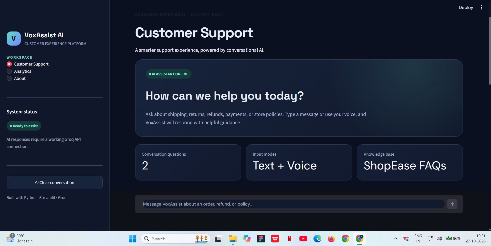
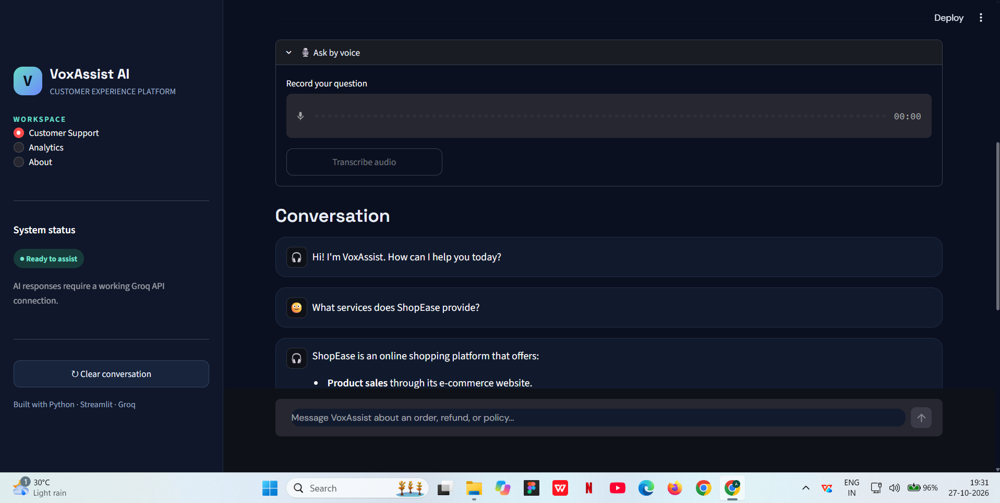
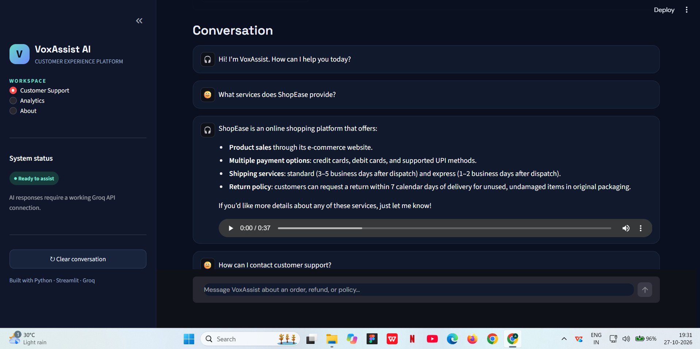
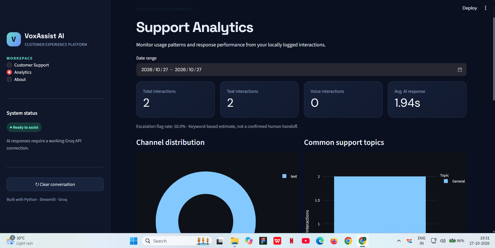
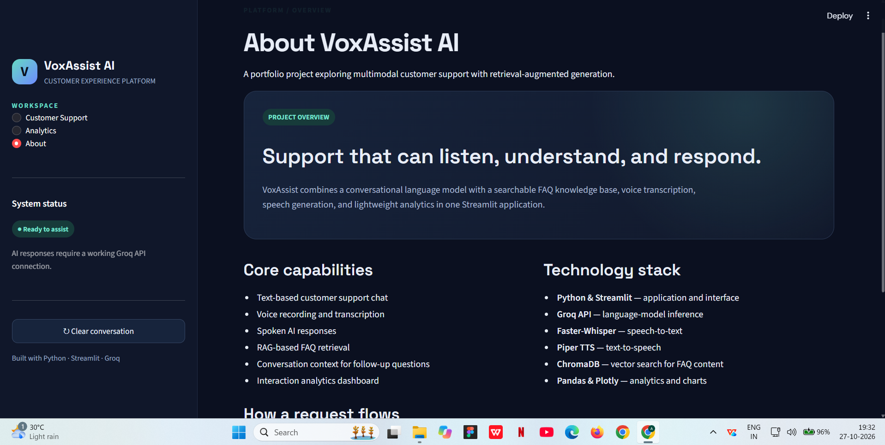

# VoxAssist AI 🎧

**An AI-powered customer support assistant with text chat, voice interaction, retrieval-augmented generation (RAG), and interaction analytics.**

VoxAssist AI is a Streamlit application that lets users ask customer-support questions by typing or speaking. It generates responses using an LLM through Groq, retrieves relevant policies from a local knowledge base, and can read answers aloud.

> **Demo scenario:** VoxAssist acts as a support assistant for a fictional e-commerce company, **ShopEase**. Its FAQ and policy content is illustrative; replace it with your own approved knowledge base before using it for a real business.

## Features

- **Text-based chat** for customer-support questions.
- **Voice input** with speech-to-text powered by Faster-Whisper.
- **Spoken answers** generated with Piper text-to-speech.
- **RAG-based policy retrieval** using ChromaDB to retrieve relevant FAQ content.
- **Conversation context** so follow-up questions can use recent messages.
- **Interaction analytics** logging channel, response time, topic, and an escalation flag.
- **Analytics dashboard** with KPIs, date filtering, channel distribution, common topics, daily trends, and recent interactions.

## Application screenshots

### 1. Customer Support Dashboard
The main interface, including workspace navigation, system status, and customer-support chat.



### 2. Voice Input and Conversation
Record a customer question, transcribe speech into text, and continue the conversation with context.



### 3. AI Response and Text-to-Speech
View an AI-generated answer grounded in the ShopEase FAQ knowledge base and play the spoken response.



### 4. Support Analytics
Review interaction counts, text and voice usage, average response time, escalation flags, and support-topic charts.



### 5. About VoxAssist AI
An overview of the project's capabilities and technology stack.



## Architecture

1. User submits a text question or records a voice question.
2. For voice input, Faster-Whisper transcribes the recording into text.
3. The application retrieves relevant FAQ/policy context from the ChromaDB knowledge base.
4. The Groq API calls the configured language model to generate a response using the retrieved context and recent conversation history.
5. Piper TTS generates audio for the response.
6. The interaction is logged locally and can be reviewed in the analytics dashboard.

## Tech stack

- **Language:** Python
- **Application UI:** Streamlit
- **LLM API:** Groq
- **Speech-to-text:** Faster-Whisper
- **Text-to-speech:** Piper TTS
- **RAG / vector storage:** ChromaDB
- **Data and visualisation:** Pandas, Plotly
- **Configuration:** python-dotenv

## Project structure

```text
VoxAssist-AI/
├── agent/
│   └── llm.py
├── analytics/
│   ├── dashboard.py
│   └── logger.py
├── data/
│   └── company_faqs.txt
├── rag/
│   └── knowledge_base.py
├── screenshots/
│   ├── 01-customer-support-home.png
│   ├── 02-voice-input-and-chat.png
│   ├── 03-ai-response-and-tts.png
│   ├── 04-support-analytics.png
│   └── 05-about-voxassist.png
├── voice/
│   ├── speech_to_text.py
│   └── text_to_speech.py
├── app.py
├── requirements.txt
└── .env.example
```

Generated files such as the local ChromaDB database, analytics CSV, virtual environment, and downloaded voice model are created or stored locally and should not be committed to the repository.

## Getting started

### 1. Clone the repository

```bash
git clone https://github.com/AbhishekBharadwaj2003/VoxAssist-AI.git
cd VoxAssist-AI
```

### 2. Create and activate a virtual environment

**Windows PowerShell:**

```powershell
py -3.11 -m venv .venv
.\.venv\Scripts\Activate.ps1
```

**macOS / Linux:**

```bash
python3 -m venv .venv
source .venv/bin/activate
```

### 3. Install dependencies

```bash
python -m pip install --upgrade pip
pip install -r requirements.txt
```

### 4. Configure the Groq API key

Create a file named `.env` in the project root and add:

```dotenv
GROQ_API_KEY=your_groq_api_key_here
```

Get an API key from the official [Groq Console](https://console.groq.com/). **Do not commit your `.env` file or expose your API key.**

The application currently configures the model `openai/gpt-oss-20b` through Groq. Model availability and API access depend on your Groq account and the provider's current offerings.

### 5. Prepare voice output

The text-to-speech module expects a Piper voice model named `en_US-lessac-medium.onnx` in the project root. Make sure the corresponding model and configuration file are available before using spoken responses. Voice model files are not included in this repository.

The first Faster-Whisper run may download its selected model, which can take time and requires an internet connection.

### 6. Run VoxAssist

```bash
python -m streamlit run app.py
```

Streamlit will print a local address in the terminal (usually `http://localhost:8501`). Open it in your browser.

## Run the analytics dashboard

Start the main app and ask a few questions so interactions are logged. In a second terminal, with the same virtual environment activated, run:

```bash
python -m streamlit run analytics/dashboard.py --server.port 8502
```

Open the local address shown for port `8502`. The dashboard reads the locally generated `data/analytics.csv` file. If there is no logged data yet, use the main app first and refresh the dashboard.

### Analytics notes

- Response time measures LLM response generation and excludes speech synthesis.
- The escalation flag is a keyword-based estimate, not a confirmed human handoff.
- Analytics are stored locally in a CSV file; no production database or multi-user analytics service is configured by default.

## Configuration and security

- Keep API keys in `.env`; never hard-code or commit secrets.
- The included ShopEase FAQs are sample content. Review and update all policies before adapting the project for real customers.
- Do not put real customer personal data into sample files or a public repository.
- This repository is a project/demo implementation, not a production-ready customer-support service. Production use would require appropriate authentication, privacy controls, monitoring, error handling, and secure data retention.

## Troubleshooting

- **Missing API key:** Check that `.env` is in the project root and contains `GROQ_API_KEY=...`.
- **Voice output fails:** Confirm the Piper model and its matching configuration file are present in the project root.
- **No analytics shown:** Submit a few questions in the main app, then refresh the analytics dashboard.
- **Dependency or installation errors:** Activate the project virtual environment and install dependencies using `python -m pip install -r requirements.txt`.

## License

No license is specified yet. Add a license file if you want to explicitly define how others may use, modify, and distribute this project.
